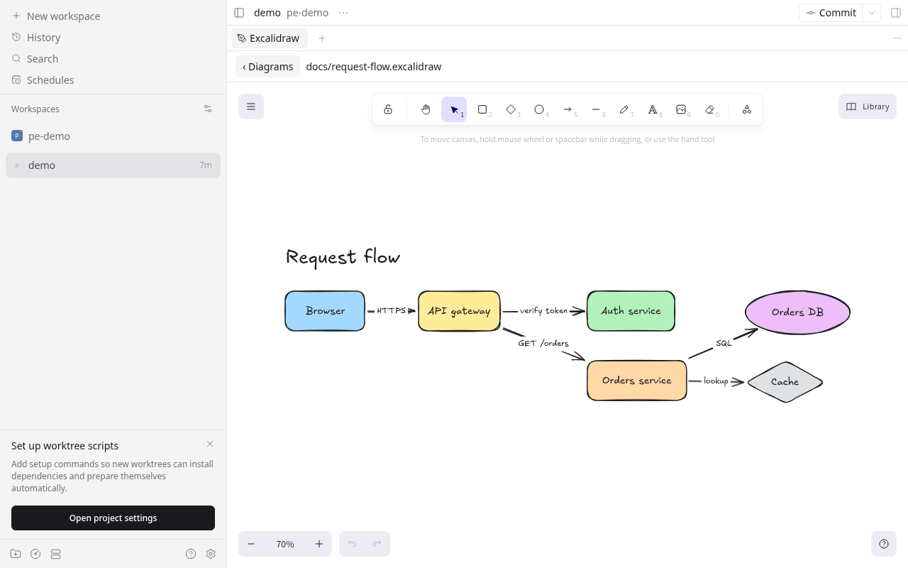

Excalidraw adds a diagram panel to your workspace. You and your agents edit the same `.excalidraw` files in the real Excalidraw editor, and changes show up live on both sides.

## Example

Ask an agent: "draw the request flow in `docs/request-flow.excalidraw`". It calls `build_diagram` once with its nodes and links, and the diagram appears in the panel, with arrows that stay attached when you move a shape.

## Features

- **The real editor**: the full Excalidraw editor in a workspace tab, bundled with its fonts so it works offline. It lists the `.excalidraw` files of the workspace and creates new ones.
- **Shared editing**: you and your agents can edit the same file at once. The panel checks the file about once a second and merges both sets of changes with Excalidraw's own reconciliation. A stale save is rejected and merged before it is saved again.
- **Diagram tools for agents**: `list_diagrams`, `read_diagram`, `create_diagram`, `add_shape`, `add_text`, `connect`, `update`, `delete`, `align` and `build_diagram`. Results are short text summaries with element ids, so small local models can use them.
- **A whole flowchart in one call**: `build_diagram` builds a whole flowchart: shapes with bound labels and arrows that stay attached.
- **Pictures that stay editable**: besides plain `.excalidraw` JSON, the panel creates, opens and saves `.excalidraw.svg` and `.excalidraw.png` files. They are real pictures with the editable scene embedded, so you can use them directly in docs.

## Get started

- Enable plugins in Paseo (Settings → Plugins), then add a tab in a workspace and choose **Excalidraw**.
- `view_diagram` returns the saved image of a `.excalidraw.png` whiteboard (max 4 MiB, 4096 px per side) so vision-capable models can read freehand sketches; the image is sent to the agent's model provider and handwriting accuracy depends on the model.
- Pi agents are off by default: enable them under the plugin's Agent tools settings only after verifying Pi MCP support on that host, since an incompatible runtime can block new Pi agents while enabled.
- Ask an agent to draw something. Agents created after the plugin is enabled get the tools automatically; older ones do not.
- Read the [README](https://github.com/lerenn/paseo-excalidraw#readme) for the file formats and how it works.

## Good to know

- Requires Paseo 0.11.2 or later. The editor runs in the desktop and web apps; on mobile the panel shows a notice, and agents can still edit diagrams.
- It only reads and writes `.excalidraw`, `.excalidraw.svg` and `.excalidraw.png` files inside the workspace folder, on the machine that runs the Paseo daemon. Paths outside it, including through symbolic links, are refused. The tools are served from a local HTTP endpoint on 127.0.0.1, protected by a secret and scoped to each agent's working directory.
- Agents can list and read image diagrams but only the panel can change them, because the picture has to be re-rendered. Images keep no record of deleted elements, so a deletion made while someone else edits the same image can come back after the merge.
- Chinese, Japanese and Korean text uses your system fonts instead of Excalidraw's bundled CJK font. The interface is English only.
